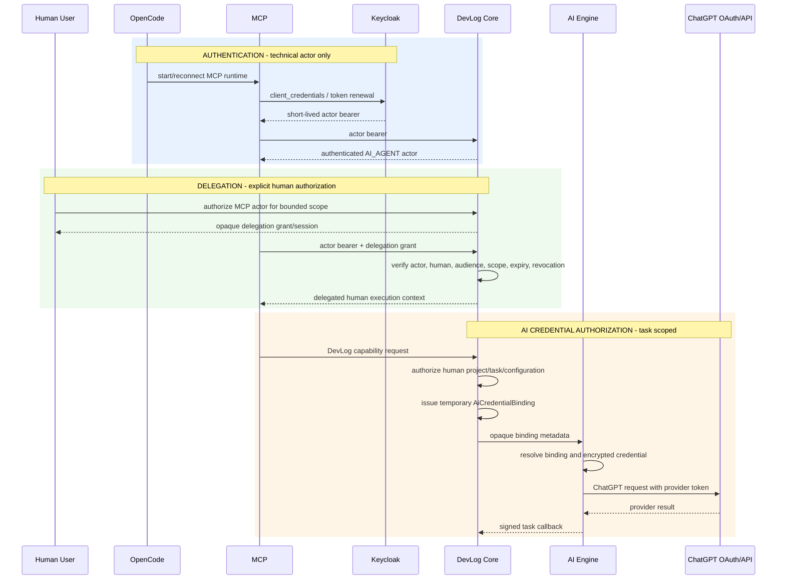

# ADR-077 - MCP Actor Identity and Human Delegation Boundary

## Status

ACCEPTED - approved by the human project owner on 2026-10-31.

## Date

2026-10-31

## Context

The investigation
[`devlog-mcp-opencode-chatgpt-oauth-stability.md`](../investigations/devlog-mcp-opencode-chatgpt-oauth-stability.md)
reconstructed the local path:

```text
OpenCode
  -> local launcher
  -> Keycloak client_credentials
  -> MCP stdio bearer
  -> Core JWT principal
  -> Core configuration and association
  -> task-scoped AiCredentialBinding
  -> AI Engine
  -> encrypted ChatGPT OAuth credential
  -> ChatGPT Responses API
```

The current launcher authenticates a technical client with
`client_credentials`. The MCP adapter currently maps every validated JWT to
`PrincipalKind.HUMAN`. No explicit, verifiable relation currently connects the
technical MCP client, OpenCode, the human DevLog user, the user's project
authority, or the user's AI credential association.

This is an identity and delegation boundary problem. It is not evidence that
OpenCode, ChatGPT OAuth, or the LLM conversation must own a durable human
identity.

ADR-070 already defines the principal vocabulary and requires Core to own
authorization, while leaving the concrete MCP authentication boundary and
service/local policy open. ADR-072 and ADR-073 separately constrain ChatGPT
credential storage and task-scoped AI credential binding.

## Problem

The system currently permits the following semantic ambiguity:

```text
technical client authentication
  -> token subject
  -> MCP PrincipalKind.HUMAN
  -> Core user configuration / project membership / AI association
```

That ambiguity creates two independent risks:

- a valid transport authentication can be mistaken for human authorization;
- a technical client can become a confused deputy by selecting or acting for a
  human without an explicit Core-verified delegation.

The transport bearer also has a separate lifecycle defect: the local launcher
obtains it once and does not renew it when it expires. Token renewal must be
designed as a transport-authentication concern, not confused with human
delegation or ChatGPT credential authorization.

## Current Behavior

### MCP transport authentication

The local OpenCode launcher requests a Keycloak access token with
`client_credentials`, exports it to the MCP process, and starts the stdio
server. The MCP server validates the token and extracts its subject.

The current MCP principal provider labels the result as `HUMAN`, regardless of
the grant used to obtain the token. The bearer is then forwarded to Core.

### Core authorization

Core resolves the authenticated principal from the validated JWT subject. It
uses that principal for project membership, AI configuration, credential
association and task authorization.

The current implementation has no approved delegation record or assertion that
binds the technical MCP actor to a human principal.

### AI credential authorization

Core owns `AiCredentialAssociation` metadata and issues an opaque,
task-scoped `AiCredentialBinding`. The AI Engine owns the encrypted ChatGPT
credential and resolves it only through the Core-issued binding.

This boundary is correct and remains separate from MCP authentication and
human delegation.

## Security Model

The architecture distinguishes three independent relationships:

1. **Authentication**: who is the technical caller at the MCP transport boundary?
2. **Delegation**: which human principal, if any, authorized that technical
   caller to act within a bounded DevLog scope?
3. **AI credential authorization**: which human-owned provider association may
   Core bind to this particular AI task?

The relationships are evaluated in that order. A successful earlier step does
not imply success of a later step.



The three rectangles are conceptual boundaries. They do not require three
different physical tokens, but any implementation must preserve the semantic
separation.

## Architectural Invariants

1. A `client_credentials` token authenticates a technical actor only. It MUST
   NOT be interpreted implicitly as `PrincipalKind.HUMAN`.
2. A technical MCP actor is represented as `AI_AGENT` when it performs bounded
   agent work for a human. A deployment-only service actor that does not act on
   behalf of a human may be represented as `SYSTEM`. The authentication grant
   does not determine the actor kind by itself.
3. The human principal and technical actor are separate identities. Core MUST
   retain both where delegation is used.
4. Core is the sole authority for principal resolution, delegation validation,
   project membership, task scope, AI configuration, credential association and
   `AiCredentialBinding` issuance.
5. A valid MCP transport bearer does not authorize access to a project or use
   of a human-owned AI credential.
6. The MCP actor MUST NOT select an arbitrary human principal, project owner,
   credential handle or binding id through tool arguments or conversation text.
7. A delegation MUST be explicit, audience-bound, actor-bound, scope-bound,
   time-bound, revocable and auditable without recording secrets or prompts.
8. `AiCredentialBinding` remains an opaque, temporary, task-scoped capability.
   It is not a delegation grant, a user session, a project token or a transport
   bearer.
9. Binding expiry MUST result in a new authorized binding for a new task. It
   MUST NOT extend the old binding or be interpreted as identity loss.
10. ChatGPT access tokens, refresh tokens, ID tokens and authorization codes
    remain inside the AI Engine provider boundary. They MUST NOT enter Core,
    MCP, OpenCode, Keycloak, prompts, callbacks or traces.
11. Authorization decisions MUST be deterministic and verifiable by Core. They
    MUST NOT depend on the model remembering an instruction or previous message.
12. OpenCode restart MUST NOT require conversational memory to reconstruct the
    authentication procedure. A local runtime may use secure non-conversational
    state, but the model is never the state holder.
13. MCP transport credentials MUST be short-lived and renewable or reacquirable
    without exposing secrets to the model. An expired bearer fails closed.
14. Technical actor registration and bootstrap MUST be reproducible from an
    approved deployment artifact. Real secrets remain external to the
    repository.
15. REST, MCP and future Developer OS agent consumers MUST converge on the same
    Core authorization and binding decisions.

## Considered Options

### Option A - MCP as technical agent with explicit human delegation

The MCP client has its own technical identity and is represented as `AI_AGENT`
when it acts for a human. Core issues and validates an explicit delegation that
connects the technical actor to the human principal for a bounded scope.

#### Delegation shape

The conceptual Core-owned record is:

```text
McpDelegationGrant
  grantId
  technicalActorId
  humanPrincipalId
  audience
  scopes[]
  projectIds[] or project scope
  issuedAt
  expiresAt
  status
  revocationReason
```

The record is a delegation capability, not an `AiCredentialBinding`. The exact
wire representation and persistence model are implementation details for a
future Story. The grant must be opaque to MCP tools and must not contain
provider secret material.

#### Creation and validation

- A human authorizes the technical actor through an authenticated Core flow.
- Core determines the human principal from that authenticated flow.
- The technical actor is identified from its authenticated transport boundary,
  not from a caller-supplied user id.
- Core creates a bounded grant only after validating the actor registration and
  the human's ability to delegate the requested project/capability scope.
- Each delegated request presents both technical actor authentication and the
  delegation proof or session reference.
- Core verifies the actor, human, audience, scope, expiry, status and replay
  policy before using the human principal for project/configuration decisions.

#### Lifecycle

The initial grant requires explicit human interaction. While it remains valid,
the MCP runtime may renew short-lived transport authentication and obtain
bounded delegated access without asking the model to repeat a procedure. A
renewal mechanism may use a revocable, short-lived session reference held by a
secure local runtime store; the mechanism must not be a ChatGPT credential and
must not be placed in OpenCode prompts or ordinary configuration.

OpenCode restart reconstructs the runtime from that secure non-conversational
state. If no valid delegation remains, the runtime returns a deterministic
reauthorization-required result. It does not guess a user, use a project slug as
identity, or silently fall back to another principal.

#### Security properties

- The technical actor cannot choose an arbitrary human.
- Core can audit both actor and human.
- Scope and expiry can be narrower than project membership.
- Future agents can use the same contract without becoming humans.
- ChatGPT credential ownership remains entirely separate.

#### Costs

- Requires a bounded delegation contract and human authorization flow.
- Requires explicit local runtime handling for delegation renewal.
- Requires careful revocation and audit semantics.

### Option B - MCP transports the human identity directly

OpenCode/MCP obtains a user-authenticated OIDC access token and presents it to
Core. Core treats the token subject as the human principal without an additional
technical-actor delegation layer.

#### Advantages

- Direct correspondence between token subject and human configuration.
- Fewer domain concepts for a single-user local deployment.
- Existing Core JWT principal resolution can remain close to its current shape.

#### Costs and risks

- A CLI/agent must obtain and renew a human access/refresh credential.
- The human credential becomes present in the OpenCode/MCP runtime boundary,
  increasing theft and lifecycle risk.
- The model/runtime distinction disappears from authorization audit data.
- Multi-agent delegation and service automation become less explicit.
- A remote MCP deployment would need a user-facing OAuth/resource-server
  contract that is explicitly out of scope in ADR-072.
- A stolen or misconfigured client could appear as the human without a separate
  actor check, increasing confused-deputy and impersonation risk.

### Comparison

| Criterion | Option A: technical actor + delegation | Option B: direct human identity |
|---|---|---|
| Human credential in OpenCode | Not required | Likely required |
| Technical actor auditability | Explicit | Collapsed into user identity |
| Confused deputy resistance | Strong with actor-bound grant | Depends on user token protection |
| Multi-agent compatibility | Strong | Limited / less explicit |
| Local UX | Initial explicit authorization | Familiar browser login, but token lifecycle is heavier |
| OpenCode coupling | Low | Higher |
| Keycloak role | Actor auth plus deployment identity | Human user auth and token renewal |
| Core authority | Preserved | Preserved, but actor distinction is weaker |
| Secret exposure risk | Delegation/session reference only | Human refresh/access credential in runtime |
| Architectural complexity | Medium | Medium, shifted into identity-token handling |

## Decision

**Option A is selected: MCP is a technical `AI_AGENT` actor and acts for a
human only through an explicit Core-owned delegation.**

This ADR does not authorize implementation or freeze a specific Keycloak OAuth
grant, JWT claim layout, database table or token format. It freezes the semantic
boundary:

```text
technical MCP actor
  + explicit Core-verified human delegation
  -> delegated human execution context
  -> Core project/configuration/task authorization
  -> Core-issued AiCredentialBinding
```

The delegated human execution context is the principal used for user-owned
project membership, provider configuration, credential association and binding
issuance. The technical actor remains available for audit, actor policy and
revocation. It is never relabeled as `HUMAN`.

Option B is rejected for the current architecture because it puts a human
identity credential into the OpenCode/MCP runtime without solving the future
multi-agent actor boundary. It may be reconsidered if a separate identity
architecture explicitly standardizes human-authenticated remote MCP clients.

## Identity Model

### Technical actor

```text
AuthenticatedPrincipal
  principalId: technical actor subject
  kind: AI_AGENT
  authenticationSource: Keycloak / approved MCP authority
```

The technical actor is deployment-registered and audience-bound. A
`client_credentials` token proves only that this actor authenticated. It does
not identify a human or grant project access.

### Human principal

```text
AuthenticatedPrincipal
  principalId: human user subject
  kind: HUMAN
  authenticationSource: approved user identity boundary
```

The human principal is established by the explicit authorization flow, not by a
project slug, MCP argument, ChatGPT subject, credential handle or model text.

### Delegated execution context

Core evaluates a delegated request using a context equivalent to:

```text
DelegatedExecution
  technicalActor: AI_AGENT principal
  humanPrincipal: HUMAN principal
  grantId: opaque non-secret audit reference
  effectiveScopes: bounded intersection of grant and Core authorization
```

The `humanPrincipal` is the subject for project and AI configuration decisions;
the `technicalActor` is the subject for transport authentication and audit.

## Delegation Model

### Issuance

Only Core may issue a delegation grant. Issuance requires:

1. an authenticated human authorization flow;
2. a registered technical actor;
3. an explicit requested scope;
4. Core validation that the human may delegate that scope;
5. an expiry and audience;
6. a replay/revocation policy.

The MCP actor cannot issue a grant to itself, choose a human id, or widen a
project scope through request metadata.

### Scope

The first implementation should use explicit capability scopes, for example:

```text
MCP_ENGINEERING_CONTEXT_READ
MCP_STORY_AGENT_EXECUTE
MCP_STORY_AGENT_READ_RESULT
```

Scopes are not project membership. The effective authorization is the
intersection of:

```text
delegation scope
∩ human project membership
∩ capability policy
∩ task/provider authorization
```

No generic IAM framework is introduced by this ADR.

### Expiry and renewal

The grant is short-lived and independently renewable only through an approved
Core flow. Transport bearer renewal does not silently renew human delegation.
When the grant is valid, the MCP runtime can renew the transport bearer without
human interaction. When the delegation itself expires or is revoked, Core
returns a bounded reauthorization-required outcome.

### Revocation

Core may revoke a grant immediately. Revocation prevents future delegated
requests and future task binding issuance. It does not rewrite historical task
records or revoke ChatGPT provider credentials automatically. Provider
credential revocation remains the separate association/AI Engine lifecycle.

## Authentication Lifecycle

1. The MCP runtime authenticates as the registered technical actor.
2. The runtime obtains a short-lived bearer for transport calls.
3. The runtime presents the Core-approved delegation reference/assertion when
   requesting delegated DevLog capabilities.
4. Core validates both actor authentication and delegation.
5. Core constructs the effective human execution context.
6. Core performs normal project, configuration and task authorization.
7. Core issues an `AiCredentialBinding` when the task requires user provider
   execution.
8. The AI Engine uses only the opaque task binding to resolve its encrypted
   provider credential.

The transport bearer and delegation reference must be renewed independently.
The model is never responsible for either renewal.

## Authorization Flow

For a user-bound MCP Story Agent request:

```text
1. Validate technical actor bearer.
2. Resolve technical actor as AI_AGENT, never HUMAN.
3. Validate delegation grant for actor, human, audience, scope, expiry and status.
4. Resolve human project membership and capability authorization.
5. Resolve human AI configuration and association state.
6. Create task.
7. Issue AiCredentialBinding scoped to human, task and provider.
8. Register opaque binding metadata with AI Engine.
9. Submit task with binding id/provider/model only.
10. AI Engine validates binding before provider execution.
```

Missing transport authentication is an authentication failure. Missing or
invalid delegation is a delegation/authorization failure. Missing or invalid
AI association is a provider-configuration failure. Expired binding is a
task-scoped capability failure. These categories must remain distinguishable in
bounded diagnostics.

## Token Renewal Expectations

The bearer used to authenticate the technical MCP actor:

- is short-lived;
- is never exposed to the model as a tool result or prompt data;
- is renewed or reacquired by the MCP runtime/launcher before or after expiry;
- is not renewed by restarting MCP as the normal mechanism;
- fails closed when renewal is unavailable;
- does not renew or widen human delegation;
- does not authorize an AI credential by itself.

The exact renewal protocol is deferred to an implementation Story. It may use
the existing Keycloak service boundary or another approved deployment
mechanism, but it must not turn the technical actor token into a human token.

## Restart Behavior

### OpenCode restart

The MCP runtime reacquires a fresh transport bearer. It restores only approved
delegation session state from a secure non-conversational runtime store, if such
state is part of the implementation. It does not depend on conversation
history, model memory or a manually repeated prompt instruction.

If the delegation is still valid, the next request continues for the same human
principal. If it has expired or been revoked, the runtime returns a deterministic
reauthorization-required result.

### MCP restart

Restart reconstructs transport authentication and reads no provider token. A
new MCP process does not create a new human identity or a new ChatGPT
credential association.

### Core or AI Engine restart

Core and AI Engine persistence rules remain governed by their existing stores.
The MCP identity/delegation contract does not make in-flight AI task execution
durable and does not extend `AiCredentialBinding` expiry.

## Revocation Behavior

Revocation is evaluated at the earliest boundary that can authoritatively know
it:

- technical actor registration revocation blocks transport authentication;
- delegation revocation blocks delegated Core capability use;
- project membership revocation blocks human project authorization;
- configuration/association revocation blocks binding issuance;
- binding revocation blocks the specific task/provider use;
- provider credential revocation is handled inside the AI Engine and its Core
  synchronization contract.

Revoking one layer must not be represented as revoking all other layers. In
particular, delegation revocation does not copy or delete ChatGPT tokens, and
binding expiry does not revoke the human identity.

## Security Analysis

| Concern | Decision treatment |
|---|---|
| Authentication | Technical actor authenticates at MCP transport; human authorization is a separate Core-verified delegation |
| Authorization | Core evaluates the delegated human against project, capability, task and configuration state |
| Delegation | Explicit, actor-bound, human-approved, scoped, expiring, revocable and auditable |
| Impersonation | MCP cannot select a human id; Core records actor and delegated human separately |
| Confused deputy | Actor, grant, audience and scope must all match before Core uses the human principal |
| Token theft | No ChatGPT credential crosses AI Engine; transport/delegation secrets are not model data and remain short-lived |
| Replay | Grant/session protocol must bind audience, expiry and replay identity; exact mechanism is Story scope |
| Expiration | Transport bearer, delegation grant, association state and task binding expire independently |
| Revocation | Each layer blocks only its own future authority and preserves audit history |
| Least privilege | Effective scope is the intersection of delegation, membership, capability and task/provider authorization |
| Auditability | Core records non-secret actor, human, grant, task and categorized decision data |
| Future multi-user | Same technical actor can delegate to different humans only through separate Core grants; no implicit selection |
| Future multi-agent | Agents remain `AI_AGENT` or `SYSTEM`; agent identity is not collapsed into `HUMAN` |

## Consequences

### Positive

- `client_credentials` receives its correct technical-actor semantics.
- Core can authorize the actual human-owned configuration and association
  without moving provider secrets.
- OpenCode is not required to store a ChatGPT access or refresh token.
- Future Developer OS agents can use the same actor/delegation boundary.
- Transport renewal, delegation renewal and AI credential authorization remain
  independently observable.
- The confused-deputy risk is addressed by construction rather than by prompt
  instructions.

### Costs and Risks

- Core needs a bounded delegation capability and lifecycle.
- A human authorization step is required to create or renew delegation.
- Local runtimes need a secure non-conversational place for any delegation
  session reference.
- Keycloak/client bootstrap must be made reproducible without versioning real
  secrets.
- Audit and error contracts need to distinguish actor, human and grant state.

## Rejected Alternatives

### Treat `client_credentials` as `HUMAN`

Rejected. It violates ADR-070's actor/authentication separation and makes the
technical client a confused deputy for user configuration and credentials.

### Let MCP provide a human principal id

Rejected. Caller-provided identity is forgeable and would allow arbitrary user
selection. Core must derive the human through explicit delegation.

### Put ChatGPT OAuth tokens in OpenCode or MCP

Rejected by ADR-072 and ADR-073. It expands the secret boundary and conflates
provider authorization with DevLog transport identity.

### Use a permanent project-wide MCP token

Rejected. It violates least privilege, makes revocation and audit ambiguous, and
would bypass human/project/task authorization.

### Make `AiCredentialBinding` the delegation mechanism

Rejected. A binding is a temporary task/provider capability, not a transport
session or human-to-agent authorization.

### Depend on conversation memory or agent instructions

Rejected. Authentication and delegation must be protocol state verified by Core.

### Direct human identity in MCP as the current default

Rejected for this ADR's V1. It would place a human access/refresh credential in
the OpenCode/MCP runtime and collapse the technical actor boundary. A future
human-authenticated MCP architecture may be considered by a separate ADR.

## Migration Impact

Existing data is keyed by the current JWT subject and may currently reflect the
technical MCP subject rather than the intended human subject. Migration must not
silently reassign project memberships, `AiUserConfiguration` rows or
`AiCredentialAssociation` rows.

The implementation plan must first inventory and classify existing records:

- valid human principal;
- technical actor principal;
- ambiguous/manual local-development principal.

Any migration from technical-subject data to human-subject data requires an
explicit human-approved migration operation with audit evidence. Existing
`AiCredentialBinding` rows remain historical and are not widened or converted
into delegation grants.

## Compatibility with Existing Credential Associations and Bindings

`AiCredentialAssociation` remains owned by Core and keyed to the **human
principal** after delegation validation. The MCP technical actor does not own or
select the association.

`AiCredentialBinding` remains:

- issued only by Core;
- scoped to one human principal, task and provider;
- opaque and non-secret;
- temporary and revocable;
- validated by AI Engine before provider execution.

The binding must not contain or be replaced by the MCP delegation grant. The AI
Engine receives neither the MCP bearer nor the human delegation proof. It
continues to receive the authorized task contract and opaque binding metadata.

ChatGPT access, refresh and ID tokens remain in the encrypted AI Engine
credential store. No change to provider secret ownership is authorized here.

## Separation from Other Stability Problems

This ADR does not decide:

- OAuth/Core runtime-state synchronization after AI Engine credential invalidation;
- durable AI Engine task execution or queue architecture;
- provider/model configuration UX or product semantics;
- a generic IAM, identity-provider or multi-tenant framework;
- ChatGPT OAuth protocol or credential storage changes.

Those may depend on the selected actor/delegation boundary, but require separate
Stories and, where ownership or trust boundaries change, separate ADR decisions.

## Follow-up Engineering Work

The recommended initial breakdown is:

1. **MCP actor and Core delegation protocol**
   - represent the technical actor as `AI_AGENT`;
   - establish human-approved Core delegation;
   - validate actor, human, audience, scope, expiry and revocation;
   - feed the delegated human principal into existing Core authorization;
   - preserve actor/human audit separation.
2. **MCP bearer renewal**
   - renew/reacquire short-lived technical authentication without model
     involvement or manual MCP restart;
   - preserve fail-closed behavior and separate bearer renewal from delegation.
3. **Reproducible Keycloak/MCP bootstrap**
   - provision the technical actor definition reproducibly;
   - keep real secrets external and rotateable;
   - define reset/restart persistence expectations.
4. **AI Engine credential invalidation synchronization**
   - propagate provider refresh/revocation failures to Core through the existing
     authenticated service boundary;
   - keep association state and future binding issuance accurate.
5. **AI Engine task durability investigation**
   - reproduce restart loss independently;
   - decide later whether durable execution is needed;
   - do not extend bindings or delegation to compensate for lost tasks.

Stories 2 and 3 can be delivered independently after the actor/delegation
contract is approved. Story 4 is related to the credential lifecycle but is not
part of MCP identity. Story 5 should remain an investigation until a measured
incident demonstrates that task loss contributes materially to the user symptom.

## ADR Assessment

This ADR refines ADR-070's open MCP authentication and service/local policy
questions. It does not replace ADR-070, ADR-072, ADR-073, ADR-075 or ADR-076.

A separate ADR is required if implementation chooses any of the following:

- a new human identity provider or a remote MCP OAuth contract;
- a change that moves delegation authority outside Core;
- a new durable credential/session ownership boundary;
- a generic multi-agent IAM framework;
- a durable task queue/execution architecture with new authorization semantics.

Transport token renewal, Keycloak bootstrap and Core/AI credential-state
synchronization can remain Engineering Stories if they preserve this ADR and
the existing ownership boundaries.

## Implementation Boundary

This ADR defines the actor, human and delegation semantics only. It does not
authorize production implementation, migration, Keycloak changes, token
rotation changes, database schema changes, or Story acceptance.

Implementation must preserve:

- Java/Core as authority for authorization and bindings;
- AI Engine ownership of provider secrets;
- explicit human delegation;
- short-lived renewable transport authentication;
- temporary task-scoped bindings;
- deterministic, fail-closed decisions;
- no provider secret in Core, MCP, OpenCode or Keycloak.

## References

- [ADR-006](ADR-006.md)
- [ADR-067](ADR-067.md)
- [ADR-070](ADR-070.md)
- [ADR-072](ADR-072.md)
- [ADR-073](ADR-073.md)
- [ADR-075](ADR-075.md)
- [ADR-076](ADR-076.md)
- [MCP/OpenCode/ChatGPT OAuth stability investigation](../investigations/devlog-mcp-opencode-chatgpt-oauth-stability.md)
