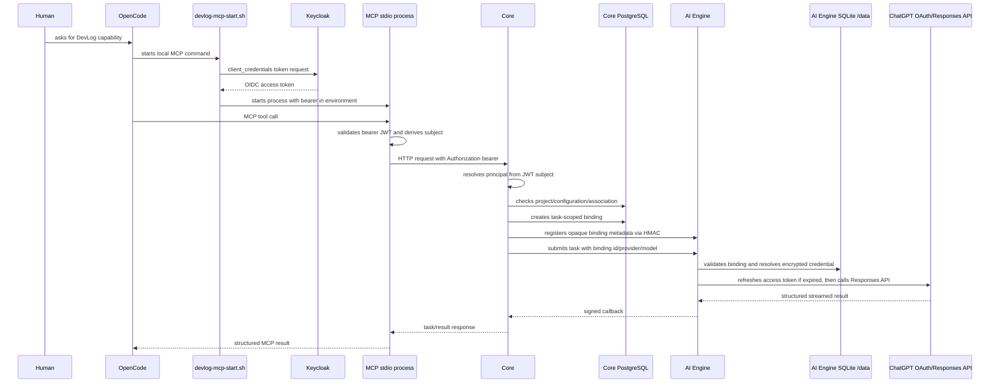

# Investigation: DevLog MCP/OpenCode/ChatGPT OAuth Stability

Investigation-only artifact. No production code, credential, runtime configuration,
ADR, or Engineering Story was modified by this investigation.

## Status

**INVESTIGATION_COMPLETE - AWAITING_HUMAN_REVIEW**

## 1. Executive Summary

The observed symptom, "OpenCode forgets how to identify or access DevLog", is not
currently demonstrated as a loss of ChatGPT OAuth credentials or as a loss of
conversation memory. The repository shows two independent identity failures at
the DevLog MCP boundary:

1. The local OpenCode launcher obtains one Keycloak `client_credentials` access
   token before starting the stdio MCP process and keeps it in the process
   environment. There is no token renewal, expiry check, or restart-on-401
   behavior. When the token expires while the MCP process remains alive, the
   MCP server forwards the expired bearer and Core rejects it. The resulting
   user-visible error is an authentication failure.
2. The launcher authenticates a technical MCP client, but the MCP adapter maps
   every validated JWT to `PrincipalKind.HUMAN` and uses the JWT subject as the
   Core principal. Core user configuration, credential associations, and project
   memberships are keyed by that principal. There is no repository evidence of
   a stable mapping from the MCP technical client to the human who started
   OpenCode. This can produce a valid MCP authentication followed by a Core
   authorization/configuration failure.

A third deployment gap makes the first failure recurrent after environment
   recreation: the launcher expects a `devlog-mcp-opencode` Keycloak client, but
   the versioned Keycloak realm imports only `devlog-core`; Keycloak has no named
   Docker volume in `docker-compose.yml`. The expected MCP client is therefore
   external, manually provisioned runtime state rather than repository-defined
   state.

The ChatGPT OAuth credential lifecycle is materially different and is mostly
durable when configured correctly. Encrypted credentials, OAuth sessions and
AI Engine binding records are stored in SQLite files under the named
`devlog-ai-bindings` volume. Core stores only an opaque handle and association
metadata. Access-token expiry can be refreshed by the AI Engine. A binding is
intentionally short-lived and is not an identity.

The smallest structural stability work is therefore not "make OpenCode remember
OAuth". It is an identity/lifecycle correction at the MCP boundary, followed by
explicit reconciliation when an AI Engine credential is invalidated. The exact
human-to-MCP principal policy is an architectural decision and should not be
implemented by inference from the current client-credentials workaround.

## 2. Observed Symptom

The reported symptom is intermittent loss of the ability to use DevLog through:

```text
DevLog -> MCP -> OpenCode -> ChatGPT OAuth (openai_chatgpt)
```

This wording is treated only as an observation. It does not establish that any
component forgot a credential, lost a database row, or failed to remember an
instruction.

## 3. Investigation Scope

Inspected:

- repository state, investigation conventions, ADRs 067, 070, 072, 073, 075 and 076;
- MCP stdio server, principal extraction, OIDC validation, Core HTTP client and tools;
- local OpenCode MCP configuration and launcher outside the repository;
- Core principal resolution, project authorization, AI configuration, association and binding services;
- ChatGPT OAuth transaction/session store, encrypted credential store, refresh path and provider execution;
- AI Engine binding registry, task authorization and Docker persistence;
- Keycloak realm import and Docker volume configuration;
- focused OAuth, credential, binding and MCP tests.

The DevLog Story Agent applicability check could not be performed because the
DevLog Story Agent capability was unavailable in the current tool set. The
repository and ADR artifacts were used as the authoritative current context.

No live OAuth flow was forced, no provider was reconnected, no token was copied
or displayed, and no real credential was changed.

## 4. Current End-to-End Flow

The real local path is:



### 4.1 OpenCode and MCP configuration

The repository contains no `.opencode/` directory and no project `opencode.json`
file. The active local configuration is outside the repository at:

```text
/home/ludo/.config/opencode/opencode.jsonc
```

Its `devlog` server is a local stdio command that runs:

```text
/home/ludo/.config/opencode/devlog-mcp-start.sh
```

The launcher:

1. reads a client secret from a machine-local file;
2. calls Keycloak with `grant_type=client_credentials`;
3. extracts one access token;
4. exports `DEVLOG_MCP_BEARER_TOKEN`;
5. starts the MCP jar.

The launcher does not persist an OpenCode identity, does not persist a human
principal, and does not implement token renewal.

### 4.2 MCP authentication

`McpOidcSecurityConfiguration` configures the MCP process as an OIDC resource
server. `FailClosedMcpAuthenticatedPrincipalProvider` obtains a bearer from,
in order:

- the MCP request transport context, when it contains `Bearer ...`;
- the Spring Security context;
- the configured `DEVLOG_MCP_BEARER_TOKEN` fallback used by stdio.

It validates issuer, subject and the configured JWT decoder. If no valid bearer
exists, it returns no principal and tools fail with an authentication error.

The provider constructs:

```text
McpPrincipal(
    jwt.subject,
    PrincipalKind.HUMAN,
    configured issuer,
    original bearer
)
```

The hard-coded `HUMAN` classification applies even when the token was issued
through `client_credentials`.

### 4.3 MCP to Core

MCP tools forward the bearer as the `Authorization` header to Core. Story Agent
snapshot polling additionally forwards the derived principal id, kind and
authentication source as diagnostic headers. Core does not trust those headers
as identity; its `RequestAuthenticatedPrincipalResolver` derives identity from
the authenticated HTTP principal/JWT.

The Core request is therefore authenticated as the JWT subject, not as an
identity inferred from the project slug, task id or MCP conversation.

### 4.4 Core principal and configuration

Core resolves an `AuthenticatedPrincipal` from the JWT subject and issuer. The
same principal id is used to query:

- project membership;
- `AiUserConfiguration`;
- `AiCredentialAssociation`;
- the credential state used to decide `READY`.

For a principal-aware Story Agent task, Core requires `READY`, creates an
`AiCredentialBinding` with a default TTL of `PT15M`, registers it with AI
Engine, and propagates only the binding id, provider, model and bounded
parameters.

### 4.5 AI Engine and ChatGPT OAuth

The product provider id `openai_chatgpt` maps explicitly to the AI Engine id
`chatgpt`. The AI Engine resolves the credential only through the task binding.
It never receives a human principal from the MCP request and it does not use an
OpenCode credential.

At provider execution:

1. resolve the binding for `(task, chatgpt)`;
2. resolve the encrypted credential handle;
3. refresh the access token when its expiry has passed and resolve the updated credential;
4. require the two plan-usage scopes;
5. call the Responses API with `store=false`, `stream=true` and the bearer token.

The access and refresh tokens stay in the AI Engine encrypted credential store.
They do not enter Core, MCP, OpenCode, prompts, callbacks or ordinary logs.

## 5. Identity and Authorization Model

### 5.1 User identity

**Fact:** Core user identity is the OIDC JWT subject, represented as
`AuthenticatedPrincipal.principalId` with an issuer and kind.

**Durability:** The principal is reconstructed from each valid request token. No
Core session is required for this path. Core configuration and associations are
persisted by that principal id.

### 5.2 OpenCode identity

**Fact:** OpenCode has no DevLog identity in the repository or in the local
launcher. It starts an MCP process. The process receives a bearer obtained by
the launcher.

**Conclusion:** OpenCode does not currently own a durable DevLog identity. It
acts as a process launcher and MCP client. The local conversation is not an
authentication mechanism.

### 5.3 MCP authentication

**Fact:** Local stdio MCP authentication is a Keycloak client-credentials token
stored only in the MCP process environment after startup.

**Owner:** The external launcher/Keycloak deployment boundary.

**Lifetime:** The token lifetime is controlled by Keycloak. The repository does
not configure or assert the access-token lifespan.

**Gap:** There is no renewal or token refresh in the launcher or MCP server.

### 5.4 Core principal

**Fact:** Core uses the JWT subject. It does not accept the MCP diagnostic
headers as an identity override.

**Gap:** A technical `client_credentials` subject is not automatically mapped to
the human who uses OpenCode.

### 5.5 Provider configuration

`AiUserConfiguration` is durable and global per authenticated principal. It
contains provider, authentication method, selected model, model-selection
origin and bounded parameters. It contains no secret.

### 5.6 Credential association

`AiCredentialAssociation` is durable in Core and unique by principal/provider.
It stores the opaque AI Engine credential handle, ChatGPT subject for OAuth,
provider-neutral authentication method, non-secret state and granted scopes.

It is not the OAuth token store and it is not a task binding.

### 5.7 Credential binding

`AiCredentialBinding` is durable metadata in Core and the AI Engine binding
registry, but intentionally temporary. It is scoped to one task, principal,
provider and credential handle. It expires after the configured TTL. A new task
must receive a new binding.

### 5.8 ChatGPT OAuth credential

The AI Engine encrypted store persists:

- access token;
- refresh token when supplied;
- access-token expiry;
- granted scopes;
- issued client id;
- ChatGPT subject;
- encrypted ID token metadata.

The store uses AES-GCM with deployment-provided key material. The SQLite file
is mounted under `/data` in the named `devlog-ai-bindings` Docker volume.

### 5.9 Provider session/runtime state

OAuth transactions are short-lived and single-use. The browser session cookie
`devlog_oauth_session` is HttpOnly, SameSite and has a one-hour max age. It maps
to an AI Engine `oauth_sessions` row. It is browser/session state, not the Core
user identity.

The AI Engine task executor uses FastAPI in-process background tasks. An
AI Engine restart can lose an in-flight task even when durable credentials and
bindings remain available.

## 6. Persistence Matrix

| Information | Owner | Storage | Durable | TTL | Reconstruction | Lost after |
|---|---|---|---|---|---|---|
| Core user identity | Keycloak/Core boundary | JWT subject; Core rows keyed by subject | Identity is external; references are durable in Core | JWT lifetime per token | New valid OIDC token | Token expiry without renewal; user/realm deletion |
| OpenCode identity | None currently | No DevLog identity record | No | None | Not applicable | Never existed as a separate state |
| MCP bearer | Launcher/MCP runtime | Process environment | No | Keycloak access-token TTL | Launcher restart only | Token expiry; MCP process lifetime |
| MCP client definition | Keycloak deployment | Runtime Keycloak config | Not in repository realm | N/A | Manual provisioning only | Keycloak recreation/reset |
| Core principal | Core | Per-request validated JWT | No session needed | JWT lifetime | JWT validation per request | Invalid/expired/missing JWT |
| Project membership | Core | PostgreSQL `project_memberships` | Yes | None shown | Query by principal | PostgreSQL volume reset |
| Provider preference | Core | PostgreSQL `ai_user_configurations` | Yes | None shown | Query by principal | PostgreSQL volume reset |
| Credential association | Core | PostgreSQL `ai_credential_associations` | Yes | None shown | Query by principal/provider | PostgreSQL volume reset; explicit revoke |
| OAuth credential | AI Engine | Encrypted SQLite `provider_credentials` | Yes if `/data` and key persist | Access-token expiry; refresh token longer-lived | Resolve by opaque handle, refresh access token | `/data` reset, key loss/rotation incompatibility, revocation |
| OAuth transaction | AI Engine | SQLite `oauth_transactions` | Yes while store exists | 300 seconds by default | Browser callback only | TTL, consumption, store reset |
| OAuth browser session | AI Engine/browser | Cookie plus `oauth_sessions` | Store durable; cookie is client state | Cookie max age 3600 seconds | New OAuth flow creates new session | Cookie expiry/deletion; store reset |
| OAuth completion code | AI Engine | SQLite `oauth_completions` | Yes while store exists | Uses OAuth transaction TTL | Core redemption/acknowledgement | TTL, consumption, store reset |
| Task binding | Core and AI Engine | PostgreSQL plus `/data/ai-bindings.sqlite3` | Yes while stores persist | `PT15M` default | New task issues a new binding | Expiry, revocation, store reset |
| AI Engine task execution | AI Engine | In-process background task | No | Process lifetime | Core task record cannot resume execution automatically | AI Engine restart while in flight |
| Prompt/task contract | Core/AI Engine | Core `AiTask` plus request | Task snapshot durable | Task lifecycle | No new identity required | Task failure/deletion |

## 7. Restart and Expiration Scenario Matrix

The "expected" column describes the current architecture and its explicit
boundaries, not an unimplemented desired behavior.

| Scenario | Initial state | Expected from current design | Observed/code outcome | First divergence | Workaround |
|---|---|---|---|---|---|
| S0 first use | No MCP process | Launcher obtains service token; Core principal must have membership/config | Works only if expected Keycloak client exists and the JWT subject owns Core rows | External client/principal provisioning | Provision client and matching principal data manually |
| S1 second task, same OpenCode/MCP process | Valid token, READY config | New task, new binding, same principal/config | Works until MCP bearer expiry; binding is reissued per task | MCP token is not renewed | Restart MCP/OpenCode; this obtains a new token |
| S2 new OpenCode session | MCP process also recreated | Launcher should obtain a fresh bearer; Core data remains | Fresh token if Keycloak client still exists; no human identity is reconstructed | Technical subject remains unrelated to human unless explicitly mapped | Recreate/repair runtime client or principal mapping |
| S3 new MCP process | MCP process stopped | Fresh client token and fresh runtime | Fresh token; OAuth credential unaffected | Missing runtime Keycloak client after recreation | Reprovision client |
| S4 Core restart | PostgreSQL volume retained | Principal/config/association/bindings remain | Durable Core rows survive | Database volume reset or changed issuer/subject | Restore volume and OIDC identity |
| S5 AI Engine restart | `/data` volume and encryption key retained | Credential/binding/OAuth stores remain; in-flight task may not | Durable state survives; in-process task may be lost | Runtime execution is not durable | Submit a new task; keep a stable volume/key |
| S6 binding expired | Association and credential valid | New task should issue a new binding | Current task binding fails closed; new task can issue one | Treating binding expiry as session loss | Submit a new task, not OAuth reconnect |
| S7 access token expired, refresh valid | Encrypted credential has refresh token | Provider refreshes and updates store | `_refresh` replaces tokens and retries resolution | None for successful refresh | No user action |
| S8 reauthorization required | Refresh absent/fails or scopes missing | Provider must fail closed and user must explicitly reconnect | Provider deletes local credential on refresh failure; Core association can remain stale as `PLAN_USAGE_AUTHORIZED` until another Core-side check | Runtime invalidation is not immediately synchronized to Core | Run configuration check/reconnect; inspect bounded state |
| S9 credential revoked | Provider or explicit disconnect revoked credential | Future use fails; explicit disconnect revokes Core association/bindings | Explicit disconnect has outbox propagation; external provider revocation is discovered later by verify/refresh | No proactive external revocation signal | Explicit reconnect after bounded failure |
| S10 full environment reset | `down --volumes`, Keycloak recreated | Nothing credential-dependent should be assumed to survive | PostgreSQL, AI Engine stores and runtime Keycloak state are lost; realm import lacks MCP client | Durable stores and client provisioning are outside one backup contract | Recreate identity/client, OAuth association and config |

## 8. Reproduction Protocol

This protocol does not require displaying or modifying a real token.

### R1 - Prove the MCP bearer lifecycle

1. Start the local MCP server through the configured launcher.
2. Record only process start time and the presence/absence of the bearer; never
   record the bearer value.
3. Call `tools/list`, then call an authenticated DevLog tool.
4. Keep the same MCP process alive beyond the Keycloak access-token TTL.
5. Call the same tool again.
6. Compare the response category and Core/MCP logs after redaction.
7. Restart only the MCP process and repeat the call.

Expected evidence from the current implementation:

- first call: valid bearer, principal derived from JWT subject;
- after expiry: decoder rejects the bearer, no principal is returned, tool
  reports authentication required or the Core call returns 401;
- after MCP restart: launcher requests a new token and the failure may disappear.

The exact expiration time is an environment value not defined in the repository.

### R2 - Prove technical-principal versus human-principal mismatch

1. Decode only non-sensitive JWT metadata in a controlled test environment:
   issuer, subject, expiry and audience. Do not persist the token or claims.
2. Record the Core principal id observed by a redacted diagnostic.
3. Query the Core configuration and project membership for that principal.
4. Compare it with the principal used by the browser/OIDC user configuration.
5. Submit a Story Agent task through MCP.

Expected divergence:

- the launcher subject is the service client subject;
- MCP labels it `HUMAN` regardless of the client-credentials grant;
- Core either finds no human configuration/membership, or uses data manually
  created for the service subject;
- the task fails before or during binding authorization, without reaching
  ChatGPT OAuth provider execution.

### R3 - Prove OAuth persistence separately

Use a disposable test directory and synthetic credentials only:

1. Create `OAuthSessionStore` and `EncryptedCredentialStore` on SQLite files.
2. Store a synthetic credential and OAuth session.
3. Destroy the service object, recreate it against the same files and key.
4. Resolve the session and credential.
5. Change the key or remove the files in a separate disposable run.

Existing tests already cover the persistence half for the binding registry and
credential store. No real OAuth callback is needed for this test.

### R4 - Prove binding expiry is not identity loss

1. Create a synthetic valid association and task.
2. Issue a binding with a short test TTL.
3. Validate it before and after expiry.
4. Issue a new binding for a new task using the same association.

Expected result: the old binding fails closed, while the new task can obtain a
new binding if association verification remains valid.

## 9. Observations

### O1 - The MCP bearer is process-scoped, not session-scoped

The launcher fetches one token and exports it before `exec java`. The MCP
provider stores the configured bearer in the component instance. There is no
refresh callback, token cache with expiry, or retry that obtains a new token.

This is a demonstrated lifecycle defect at the launcher/MCP boundary.

### O2 - The MCP client is not a human identity

The launcher uses `client_credentials`. `FailClosedMcpAuthenticatedPrincipalProvider`
nevertheless creates `PrincipalKind.HUMAN`. ADR-070 explicitly separates actor
classification from authentication mechanism and says that a service mechanism
must not be confused with the actor.

The implementation therefore loses the distinction between "the technical MCP
client authenticated" and "the human user authorized this request".

### O3 - The expected MCP client is not repository-defined

The local launcher expects a client id and a machine-local secret file. The
versioned Keycloak realm imports only `devlog-core`. The Keycloak service has no
named volume in `docker-compose.yml`.

This makes a clean Keycloak recreation a likely source of an immediate token
acquisition failure. It is not an OAuth credential loss; it is missing
deployment identity provisioning.

### O4 - Core and ChatGPT OAuth are separated correctly in storage

Core stores the association and opaque handle. AI Engine stores encrypted OAuth
tokens. The binding is task-scoped. No code path inspected copies a ChatGPT
token into Core, MCP or OpenCode.

### O5 - ChatGPT OAuth browser session is not the task identity

The OAuth browser cookie and `oauth_sessions` row identify an AI Engine OAuth
transaction/session. They do not establish the Core principal for later MCP
requests. A new browser session can appear disconnected while Core still has a
valid association, and a new OAuth transaction can be started without finding
the prior session handle by human identity.

### O6 - Refresh success is durable; refresh failure is only locally destructive

On successful refresh, the encrypted credential store is updated. On refresh
failure, the AI Engine deletes the credential and returns a reauthorization
error. It does not call the Core revocation endpoint from the provider refresh
failure path. Core may consequently retain a stale `PLAN_USAGE_AUTHORIZED`
association until a later verification or explicit user action.

### O7 - In-flight task execution is not durable

The AI Engine README explicitly states that FastAPI in-process background tasks
can be lost on process stop. This is separate from identity and credential
persistence but can look like a post-restart authentication failure if the
caller only sees that no result arrives.

### O8 - The default local reset semantics destroy the relevant stores

`docker compose down` preserves named volumes, while `down --volumes` destroys
them. The ChatGPT credential, OAuth session and AI binding SQLite files are in
the AI Engine volume. Core configuration and associations are in PostgreSQL.
Both are lost after a full volume reset.

## 10. Root Causes

### RC1 - Stale non-renewed MCP access token

- **Symptom:** DevLog calls stop working after the MCP process has been alive for
  the token lifetime.
- **Reproduction:** R1.
- **Root cause:** launcher fetches one client-credentials token; MCP does not
  renew or replace it.
- **Owner:** OpenCode local launcher/MCP authentication boundary.
- **Lost/incorrect state:** current bearer validity, not Core identity or ChatGPT credential.
- **Why allowed:** MCP stdio was implemented as a static configured bearer,
  although the bearer is a time-limited JWT.
- **Impact:** authenticated MCP calls fail until process restart.
- **Frequency:** whenever a long-lived MCP process outlives the JWT; exact rate
  depends on Keycloak TTL.
- **Workaround:** restart OpenCode/MCP.
- **Severity:** High for reliability; no evidence of secret disclosure.

### RC2 - Technical MCP principal is misclassified and not mapped to the human

- **Symptom:** MCP can authenticate but Core cannot find the expected user
  configuration/membership or binds execution to the wrong principal.
- **Reproduction:** R2.
- **Root cause:** client-credentials subject is mapped to `HUMAN` without an
  explicit human delegation or principal mapping contract.
- **Owner:** MCP/Core identity boundary.
- **Lost/incorrect state:** human execution identity, not ChatGPT OAuth token.
- **Why allowed:** the current implementation chose a service token workaround
  while the principal/delegation policy remained unresolved in ADR-070.
- **Impact:** persistent user configuration and credential associations cannot
  be deterministically selected for the real human.
- **Frequency:** every use unless data is intentionally provisioned under the
  technical subject.
- **Workaround:** manually make the technical subject own project/configuration
  data, which is unsafe and semantically wrong for multi-user use.
- **Severity:** Critical architectural correctness issue for user-bound execution.

### RC3 - MCP client provisioning is external and ephemeral in local Docker

- **Symptom:** after Keycloak recreation, the launcher cannot obtain a token.
- **Reproduction:** S10 plus the realm/compose inspection.
- **Root cause:** expected MCP client is absent from the versioned realm and
  Keycloak has no persistent volume.
- **Owner:** local deployment/bootstrap configuration.
- **Lost/incorrect state:** technical MCP client registration, not OAuth user credential.
- **Impact:** OpenCode cannot start an authenticated MCP runtime at all.
- **Frequency:** after Keycloak container recreation/reset unless manually re-provisioned.
- **Workaround:** manually recreate the client and secret.
- **Severity:** High for reproducibility; deployment configuration gap.

### RC4 - Runtime credential invalidation is not immediately reflected in Core

- **Symptom:** Core can retain a ready-looking configuration after AI Engine
  refresh failure or external credential invalidation.
- **Reproduction:** S8/S9 using synthetic store state and provider failure tests.
- **Root cause:** provider refresh failure deletes the local credential but does
  not synchronously notify/revoke the Core association.
- **Owner:** AI Engine/Core credential lifecycle integration.
- **Impact:** the next task fails later during association verification or binding
  issuance, with a misleading configuration state.
- **Frequency:** only when refresh or provider validation fails.
- **Workaround:** run configuration test or explicitly reconnect/revoke.
- **Severity:** Medium; it amplifies the primary identity symptom.

## 11. Contributing Factors

- OpenCode configuration and launcher are outside the repository, so the
  repository cannot reproduce the local MCP identity setup from a clean checkout.
- The configured issuer uses a Docker-internal hostname while the host launcher
  uses a host-published JWKS URL; this is valid only when the issuer claim and
  validator configuration remain aligned.
- Keycloak access-token TTL is not versioned or documented, so the stale-token
  failure window is unknown.
- The MCP protocol path does not establish a human login or delegation exchange.
- Core user configuration is global per principal, so choosing the wrong
  principal affects provider selection, model selection, association and project
  authorization simultaneously.
- In-process AI Engine execution can lose a submitted task during restart,
  creating a failure that is easy to attribute incorrectly to credentials.
- The current local launcher treats successful token acquisition as sufficient
  authentication, but does not verify that the resulting principal is usable
  for the requested DevLog project and user-bound provider path.

## 12. Unknowns

The following were not proven from repository evidence or a live credential-safe
run:

- exact Keycloak access-token TTL in the currently running environment;
- whether the manually provisioned `devlog-mcp-opencode` client exists in the
  current Keycloak runtime despite being absent from the imported realm;
- whether current Core PostgreSQL data has configuration/membership rows keyed by
  the MCP technical subject;
- whether the reported failure occurs after token expiry, after Keycloak
  recreation, after a Core/AI restart, or after an OAuth provider refresh failure;
- whether the current MCP process is recreated for each OpenCode session or
  reused by the local OpenCode runtime;
- whether external ChatGPT revocation occurs without a provider call that
  exercises refresh or association verification;
- the exact public error observed by the human, because no real failure session
  was captured and no secret-bearing log was inspected.

These unknowns require a controlled environment run with redacted diagnostics,
not an architectural guess.

## 13. Security Implications

Positive properties confirmed:

- OAuth access, refresh and ID tokens are encrypted in the AI Engine store.
- Core receives only opaque handles and non-secret association metadata.
- Bindings are task-scoped, expiry-bound and fail closed.
- No automatic API-key/provider fallback exists.
- MCP rejects missing or invalid bearer authentication.
- OAuth state, PKCE, nonce, scope and callback completion are bounded and
  replay-protected.

Risks identified:

- Misclassifying a technical client as `HUMAN` can grant or deny rights to the
  wrong actor if data is provisioned under the service subject.
- A static bearer in a long-lived process extends the practical exposure window
  until token expiry and makes lifecycle behavior opaque.
- A machine-local MCP client secret and external Keycloak client are not part of
  the repository deployment contract.
- A stable token-renewal design must not log, persist in OpenCode, or expose
  refresh material to MCP tools or the model.
- Any future human delegation must preserve Core's rule that project and
  provider authorization are derived from the authenticated/delegated principal,
  not from project slug or conversation context.

## 14. Stability Invariants

The following are supported by the evidence and should become acceptance
invariants for future work:

1. A valid MCP runtime can renew or reacquire its own transport token without
   exposing token material to OpenCode tools or the LLM.
2. An expired MCP transport token is distinguishable from a missing human
   principal, expired task binding and invalid ChatGPT credential.
3. A technical MCP client is not classified as `HUMAN` unless an explicit,
   approved delegation contract establishes that actor semantics.
4. A new OpenCode session can reconstruct the intended DevLog actor through a
   deterministic authentication/delegation mechanism; it must not rely on
   conversation memory.
5. Core configuration and credential association lookup use the same stable
   principal across REST, MCP and task execution.
6. A valid persisted ChatGPT credential does not require OAuth reauthorization
   merely because OpenCode, MCP, Core or AI Engine restarted.
7. A binding expiration creates a new binding for a new task; it never revives or
   extends the old binding and never implies identity loss.
8. Access-token refresh success updates only the AI Engine credential store.
9. Refresh failure or provider revocation transitions Core-visible runtime state
   to a bounded reauthorization/revoked state without secret disclosure.
10. Full-environment reset semantics explicitly state which identity, database,
    credential and deployment-registration stores are restored or re-provisioned.
11. OpenCode/MCP bootstrap configuration is reproducible from an approved
    deployment artifact, while secrets remain external.
12. A lost in-flight task after AI Engine restart is reported as execution
    durability failure, not as authentication or OAuth credential loss.

## 15. Architecture Gaps

| Area | Gap classification | Evidence |
|---|---|---|
| OpenCode configuration | Deployment/reproducibility gap | Active config and launcher are outside repository |
| MCP authentication | Lifecycle gap | Static bearer, no renewal or expiry handling |
| MCP principal resolution | Architecture gap | Technical client token classified as `HUMAN` |
| Human delegation | Unspecified decision | No mapping from MCP client to human principal |
| Keycloak bootstrap | Deployment gap | Expected MCP client absent from realm import; no Keycloak volume |
| Core principal resolution | Locally correct but identity-dependent | JWT subject is used consistently |
| Provider configuration | Durable and explicit | Core per-principal `AiUserConfiguration` |
| Credential association | Durable but stale-state-prone | Core association can outlive AI Engine credential invalidation |
| Credential binding | Correctly ephemeral | 15-minute task scope and fail-closed validation |
| OAuth persistence | Durable conditionally | Requires AI `/data` volume and stable encryption key |
| OAuth refresh lifecycle | Mostly implemented; synchronization gap | AI refreshes/deletes locally; Core is not immediately informed on all failures |
| AI Engine runtime | Execution durability gap | In-process background task can be lost on restart |

## 16. Solution Options

### Option A - Local launcher token renewal only

- **Description:** Make the launcher/MCP boundary reacquire a service token
  before expiry or after a bounded 401.
- **Modified component:** local launcher and MCP authentication adapter.
- **Durable/reconstructible state:** transport token is reconstructible; no
  refresh token is stored in OpenCode.
- **Security:** preserves service secret boundary; requires careful redaction.
- **UX:** removes failures caused solely by long-lived MCP runtime.
- **Complexity:** Low to medium.
- **Migration:** None for existing Core data.
- **ADR compatibility:** Compatible only as a transport fix; it does not solve
  human delegation.
- **Risk:** leaves the technical-as-human principal defect unchanged.

### Option B - Explicit MCP actor/delegation contract

- **Description:** Decide whether local MCP represents a system/AI agent or an
  authenticated human, then implement a stable, explicit mapping/delegation
  boundary. Core must authorize the resulting principal.
- **Modified component:** Keycloak/MCP/Core boundary and local bootstrap.
- **Durable/reconstructible state:** actor identity is reconstructed from an
  approved token/delegation contract; no ChatGPT secret moves.
- **Security:** highest architectural value; avoids silently treating a service
  account as a human.
- **UX:** new OpenCode sessions can authenticate deterministically.
- **Complexity:** Medium to high.
- **Migration:** project memberships, configuration and associations may need a
  controlled principal migration only if the chosen identity changes.
- **ADR compatibility:** requires a concrete decision under ADR-070 before code.
- **Risk:** choosing an identity model without product owner approval would
  silently change authorization semantics.

### Option C - Reproducible Keycloak/MCP deployment bootstrap

- **Description:** Version the non-secret MCP client definition or provisioning
  contract, persist Keycloak state appropriately, and document secret injection.
- **Modified component:** Docker/Keycloak deployment artifacts and runbook.
- **Durable/reconstructible state:** technical client registration is restored;
  secret remains external.
- **Security:** avoids committing client secrets; requires rotation procedure.
- **UX:** full environment reset becomes predictable.
- **Complexity:** Low to medium.
- **Migration:** Existing local manual clients must be reconciled.
- **ADR compatibility:** deployment decision; no OAuth credential change.
- **Risk:** still does not identify the human by itself.

### Option D - Core association freshness/revocation synchronization

- **Description:** When AI Engine invalidates a credential during refresh or
  verification, notify Core through the existing authenticated service boundary
  and transition the association/bindings.
- **Modified component:** AI Engine/Core credential lifecycle.
- **Durable/reconstructible state:** Core runtime state becomes reconstructible
  from the actual AI credential state.
- **Security:** fail closed; no token transfer.
- **UX:** reports reauthorization instead of a later generic task failure.
- **Complexity:** Medium.
- **Migration:** None beyond state transition handling.
- **ADR compatibility:** aligned with ADR-072/073/075.
- **Risk:** must define idempotency and failure behavior for notification.

### Option E - Durable task execution/retry

- **Description:** Replace in-process background execution with a durable
  execution mechanism.
- **Modified component:** AI Engine task runtime.
- **Durable/reconstructible state:** in-flight task execution becomes recoverable.
- **Security:** must preserve binding expiry and never extend authorization.
- **UX:** fewer restart-related missing-result symptoms.
- **Complexity:** High.
- **Migration:** execution lifecycle and retry policy.
- **ADR compatibility:** likely requires separate architecture work.
- **Risk:** scope expansion; not the primary identity defect.

## 17. Recommended Direction

Do not add persistence to OpenCode and do not move ChatGPT tokens to Core or
MCP.

First establish the actor model under ADR-070:

1. decide whether the local MCP process is a system/agent actor or an explicit
   human-delegated actor;
2. define how that actor obtains/renews transport authentication;
3. define how Core maps the actor to the human configuration and project scope;
4. make the Keycloak/MCP bootstrap reproducible without committing secrets.

In parallel, add a separate credential-state synchronization decision for the
refresh-failure path. Keep binding expiry explicitly temporary and keep OAuth
tokens inside AI Engine.

The first controlled experiment should capture redacted categories for one
complete run:

```text
MCP token acquired
-> MCP token accepted/rejected
-> Core principal id hash and kind
-> project membership decision
-> configuration state
-> association verification state
-> binding issuance/validation
-> provider refresh result
-> task result
```

No token, prompt, repository content or provider payload should be captured.

## 18. Recommended Work Unit

**ADR + Engineering Stories**, not a local fix and not yet a broad Epic.

Reasoning:

- The stale-token renewal is a bounded local/deployment Story.
- The technical-client-versus-human-principal problem changes authorization
  semantics and requires an explicit ADR-070 follow-up or amendment.
- Keycloak bootstrap and credential-state synchronization are separate bounded
  Stories.
- Durable task execution is a later candidate only if the real incident data
  shows that in-flight task loss is part of the reported symptom.

An Epic should be created only if the controlled reproduction confirms that all
of the actor model, token lifecycle, deployment bootstrap and credential-state
synchronization must be delivered together.

## 19. ADR Assessment

No new ADR was created by this investigation.

An ADR update or follow-up decision is required before implementing the human
delegation model because ADR-070 explicitly leaves the concrete identity provider,
MCP authentication boundary and service/local policy as follow-up questions.

ADR-072 and ADR-073 do not need to be reopened for the transport-token issue.
They already prohibit moving ChatGPT tokens to Core/MCP and preserve the Core
binding boundary. Any change to association refresh/revocation semantics should
be checked against those ADRs but can likely be a focused implementation Story
if no ownership boundary changes.

## 20. Proposed Next Steps

1. Human review this investigation and confirm the reported failure window:
   token-age, OpenCode-session boundary, service restart, full Docker reset, or
   provider refresh failure.
2. In a disposable environment, run R1 and R2 with redacted diagnostics only.
3. Inspect the live Keycloak client registration and compare its subject with
   the Core project membership/configuration subject; do not modify production
   or personal credentials.
4. Decide the MCP actor/delegation model under ADR-070.
5. Create the smallest authorized Stories for token renewal, reproducible MCP
   bootstrap and credential-state synchronization.
6. Reassess whether durable AI Engine task execution is implicated before
   creating any Epic.

## Evidence and Validation

Repository evidence inspected includes:

- `mcp-server/.../FailClosedMcpAuthenticatedPrincipalProvider.java`;
- `mcp-server/.../McpOidcSecurityConfiguration.java`;
- `mcp-server/.../EngineeringContextTool.java` and `DevLogStoryAgentTool.java`;
- `/home/ludo/.config/opencode/devlog-mcp-start.sh` and its local OpenCode MCP configuration;
- `backend/.../RequestAuthenticatedPrincipalResolver.java`;
- `backend/.../OAuthConnectionIntentService.java`;
- `backend/.../AiCredentialAssociationServiceImpl.java`;
- `backend/.../AiCredentialBindingServiceImpl.java`;
- `backend/.../AiTaskExecutionAuthorizationService.java`;
- `ai-engine/app/services/chatgpt_oauth.py`;
- `ai-engine/app/security/credential_store.py`;
- `ai-engine/app/services/binding_registry.py`;
- `ai-engine/app/providers/chatgpt.py`;
- `docker-compose.yml` and `docker/keycloak/devlog-realm.json`;
- ADR-067, ADR-070, ADR-072, ADR-073, ADR-075 and ADR-076;
- Stories 0154, 0160, 0161, 0165 and 0169 artifacts.

Focused validation executed without real credentials:

```text
ai-engine: uv run pytest -q tests/test_chatgpt_oauth.py tests/test_chatgpt_auth.py \
  tests/test_credential_store.py tests/test_credential_resolver.py \
  tests/test_binding_registry.py tests/test_service_auth.py
  -> passed

mcp-server: ./mvnw -q -Dtest=FailClosedMcpAuthenticatedPrincipalProviderTest,\
  DevLogStoryAgentToolTest,StoryContextAgentProtocolToolTest test
  -> passed
```

The tests prove the persistence and fail-closed boundaries; they do not prove a
live Keycloak token-renewal path or a live ChatGPT provider call.

## Repository State

- Branch: `main`.
- Worktree was clean before this investigation artifact.
- No functional source, credential, Docker runtime state or ADR was modified.
- This document is the only intended repository change.

*Generated from repository evidence and controlled local tests. If a live,
redacted reproduction contradicts this document, runtime evidence should refine
the diagnosis before implementation begins.*
